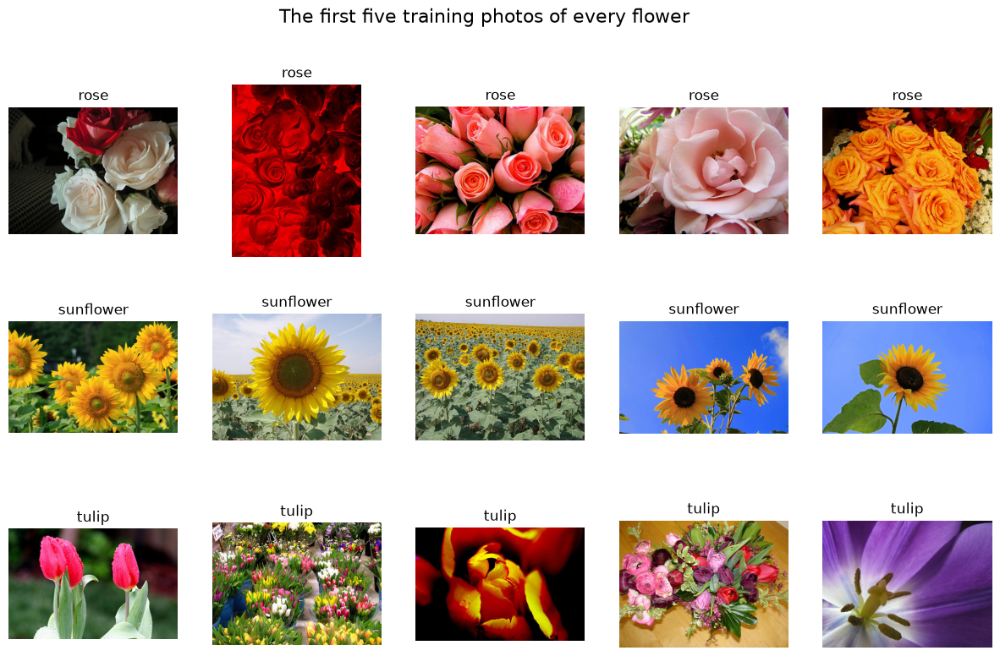
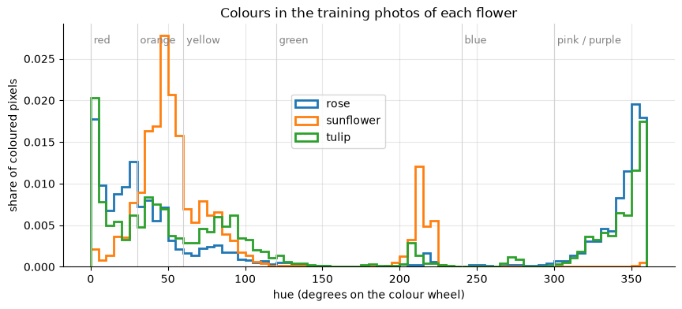
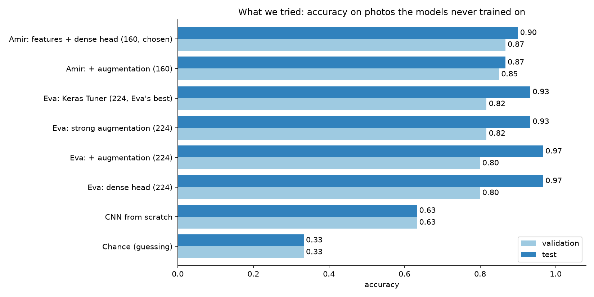
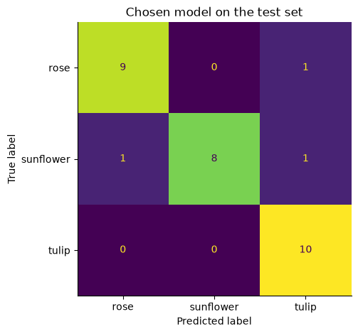
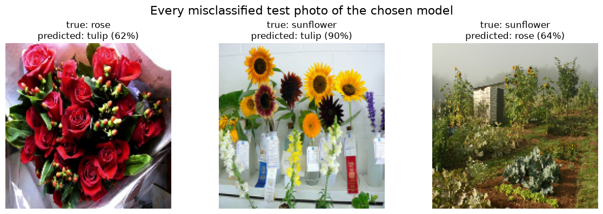
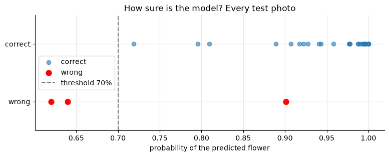

<!-- _paginate: false -->

# Which Flower Is It?

## Choosing the right care guide from a photo with transfer learning

Eva & Amir · Flower Classification Project · Week 5

<!--
Hi, I'm Amir. Eva and I worked on this project together. In the next five minutes I show how a garden centre can pick the right care guide from a customer's photo, with only 100 photos per flower.
-->

---

## The problem

- A garden centre sends customers a **care guide** for the flower in their photo
- Today a **member of staff** looks at **every** photo and picks the guide by hand
- Start with the three most requested guides: **rose, sunflower, tulip**
- Only **100 training photos per flower**

**Question:** can a model pick the guide, and **when can the garden centre trust it?**

<!--
Today every photo needs a person. We want a model that takes over the easy cases, and we want to know when it should not be trusted. Only 100 photos per flower is very little data for a neural network.
-->

---

## The data

 

- 300 training, 60 validation, 30 **test** photos (locked until the end), balanced
- **Sunflowers:** yellow, plus blue sky · **Roses and tulips:** almost the same colours → the model must learn **shape**

<!--
The classes are balanced, so accuracy is a fair metric. The photos are very varied: close-ups, fields, bouquets.
The colour plot shows: sunflowers are yellow and often photographed against blue sky. Roses and tulips have almost the same colours, red and pink. So for those two the model needs shape, not colour.
-->

---

## Looking deeper at the data (Eva)

<style scoped> table { font-size: 19px; } </style>

| Check | Finding | What it means for the model |
|---|---|---|
| Width, height and aspect ratio **per flower** | Almost all photos are landscape (4:3); all three flowers have the **same shapes** | Resizing to a square squeezes every flower the same way: no false hint like "squeezed = tulip" |
| Hue of all coloured pixels | Sunflowers: yellow + a **blue sky** peak · roses and tulips: red and magenta | Sunflowers are easy by colour; the model may also use the sky |
| **Dominant colour per photo** | Roses and tulips very similar; tulips more often **dominantly green** (stems and leaves) | Colour barely separates roses from tulips |
| **Saturation and brightness** per flower | Roses and tulips almost identical | The model has to learn **shape**: open, layered roses against closed tulip cups |

<!--
Before modelling, Eva looked at the data more closely. All flowers have the same photo shapes, so resizing them to a square is fair. Colour separates sunflowers, but roses and tulips are almost identical in colour, saturation and brightness. So we expected the model to need shape for these two.
-->

---

## Our approach: transfer learning

```text
photo  ->  MobileNetV2 base (frozen)  ->  1,280 features  ->  small head  ->  rose / sunflower / tulip
           pretrained on 1.4 million photos                    trained by us
           2,257,984 weights, not changed                      3,843 weights
```

- 300 photos are too few to train a network from scratch
- **Reuse** a network that already learnt to see: keep its base, replace its 1,000-class top
- **Freeze** the base: protects what it learnt, and only 3,843 weights have to be learnt from our photos

<!--
Instead of training from scratch, we reuse MobileNetV2. It was trained on 1.4 million ImageNet photos and already detects edges, textures and shapes. We keep that part frozen and only train a small new head for our three flowers: 3,843 weights instead of millions.
-->

---

## What we tried: overview



<!--
Here is every model we trained, on photos they never trained on: light blue is the validation set (60 photos), dark blue the test set (30 photos).
Chance is 33 percent. A CNN from scratch reaches 63. Every transfer learning model, mine and Eva's, is far above that: 80 to 97 percent.
Interesting: my model is best on validation, Eva's are best on test. The differences are 1 to 4 photos, so that is noise from small data.
The next two slides show what each of us tried, and what worked.
-->

---

## Experiments (1/2): Amir · 160 x 160 pixels

<style scoped> table { font-size: 18px; } </style>

| Experiment | Idea | Validation (60) | Test (30) | Worked? |
|---|---|---|---|---|
| CNN from scratch | Baseline: all weights learnt from our 300 photos | 0.633 (38) | 0.633 (19) | ❌ overfits strongly, but **proves** we need transfer learning |
| **Frozen MobileNetV2, features once + dense head** | Reuse the pretrained base, train only 3,843 weights | **0.867 (52)** | **0.900 (27)** | ✅ **chosen**: best and simplest, trains in seconds |
| + data augmentation | Flip, rotate, zoom to reduce overfitting | 0.850 (51) | 0.867 (26) | ⚠️ less overfitting (gap 0.13 → 0.10), not more accuracy |
| + early stopping | Stop at the lowest validation loss | 0.833 (50) | – | ⚠️ more honest probabilities, 2 photos fewer |

<!--
My part: I started with a CNN from scratch as a baseline: 63 percent, and it memorised the training photos. Transfer learning with a frozen MobileNetV2 and a small head reached 87 percent on validation, 90 on test.
Augmentation and early stopping reduced overfitting, but did not get more photos right. So the simple model stayed our choice.
-->

---

## Experiments (2/2): Eva · 224 x 224 pixels

<style scoped> table { font-size: 18px; } </style>

| Experiment | Idea | Validation (60) | Test (30) | Worked? |
|---|---|---|---|---|
| Dense head, base inside the model | The same idea at the original MobileNetV2 size | 0.800 (48) | 0.967 (29) | ⚠️ 4 validation photos fewer than at 160, but the best test score |
| + augmentation | Flips (horizontal **and** vertical), rotation, zoom | 0.800 (48) | 0.967 (29) | ⚠️ less overfitting, same accuracy: the vertical flip neither helped nor hurt |
| **Keras Tuner (Hyperband)** | 30 settings: augmentation strength, dropout, hidden layer, L2, learning rate; objective: validation **loss** | **0.817 (49)** | 0.933 (28) | ✅ **Eva's best**: lowest validation loss (0.47) |
| Strong augmentation, by hand | + shift, brightness, random erasing; hidden layer 64, learning-rate decay, early stopping | 0.817 (49) | 0.933 (28) | ⚠️ same accuracy as the tuner, higher validation loss (0.57) |

**The tuner's choice:** no hidden layer, dropout 0.2, a small learning rate, light augmentation: **the simplest head won**, as in our own comparison.

<!--
Eva trained at 224 x 224, the original MobileNetV2 size, with the base inside the model: 48 of 60 validation photos, 29 of 30 test photos.
Her augmentation included a vertical flip, which we had decided against. It reduced overfitting, but did not change the accuracy at all, so it neither helped nor hurt.
Then she let Keras Tuner try 30 settings. The best one has no hidden layer, little dropout and a small learning rate: the simplest head won again. It has the lowest validation loss of all our models, so its probabilities are the most honest.
Her strong augmentation by hand reached the same accuracy, with a higher loss.
-->

---

## What worked, what didn't, and what we decided against

<style scoped> table { font-size: 19px; } </style>

| ✅ Worked | ⚠️ Helped a little / no effect | ❌ Did not work / decided against |
|---|---|---|
| **Transfer learning**: 0.63 → 0.80–0.87 on validation | Augmentation (both of us): less overfitting, not more accuracy | CNN from scratch: too little data |
| Freezing the base: only 3,843 weights to learn | Early stopping, Keras Tuner: more honest probabilities, ± 1 photo | **Colour changes**: colour is a key clue for sunflowers |
| **The simplest head**: our comparison **and** the tuner chose it | 224 instead of 160 pixels: not better on validation | Cropping to a square: could cut off the flower |
| Scaling **inside** the model: the app gets the same preparation | **Vertical flip** (Eva tried it): no effect, 48 of 60 with and without | |

**Lesson:** with 300 photos, the **pretrained features do most of the work**. Our model is best on validation, Eva's on test, by **1 to 4 photos**: that is noise, so we choose by validation and keep the simplest model.

<!--
Summary. Transfer learning is the big win. Augmentation, early stopping and the tuner helped with overfitting and with honest probabilities, but changed the accuracy by only one photo or so. Both our own comparison and Keras Tuner ended up with the simplest head.
We disagreed about the vertical flip: Eva tried it, and it made no difference. Colour changes we left out on purpose.
The lesson: with 60 validation and 30 test photos, differences of a few photos are noise, so we choose by validation and keep the simplest model.
-->

---

## Final result on the test set

<div class="big">27 / 30 correct</div>

**90 % test accuracy**



- 30 photos the model **never saw** during any decision
- Validation was a fair estimate: 0.867 → 0.900 (one photo = 3.3 points)
- All 10 tulips correct · **2 of the 3 mistakes are sunflowers**, not roses vs tulips

<!--
The test set was used only once, at the very end. 27 of 30 are right.
Surprise: we expected roses and tulips to be confused, but two of the three mistakes are sunflowers, the class that looked easiest.
-->

---

## When can the garden centre trust it?

 

- Every mistake is a **bouquet, a display or a far-away shot**, never a close-up of one flower
- **Below 70 % sure → a member of staff checks:** catches 2 of 3 mistakes, only 2 of 30 photos need a person
- Eva's best model confirms it: its 2 test mistakes (a far-away rose, an orange rose) are at **41 % and 58 %**

<!--
The three wrong photos have one thing in common: none is a close-up of a single flower.
And the model is less sure when it is wrong: two of the three mistakes are below 70 percent. So the rule is: below 70 percent, a member of staff checks. On the test set that catches two of three mistakes, and only 2 of 30 photos need a person.
One confident mistake at 90 percent still slips through.
Eva's best model shows the same pattern: its two test mistakes, a rose far away in a landscape and an orange rose, come with only 41 and 58 percent, so the staff check would catch both.
-->

---

## Live demo

```text
customer uploads a photo  ->  model
                                |-- at least 70 % sure:  care guide sent automatically
                                '-- below 70 % sure:     a member of staff checks the photo
```

1. A clear **sunflower** → green: *"This is a sunflower (96 %)"*
2. The **rose bouquet** → yellow: *"Not sure (62 %): a tulip or a rose? A member of staff will check"*

<!--
Switch to the app now: uv run streamlit run app.py, dense_head.keras is selected automatically.
Upload the clear sunflower: green box.
Upload the rose bouquet (data/test/rose, first file): yellow box, staff check.
If the demo fails: show screenshots.
-->

---

## Recommendation

- ✅ Use the model: **9 of 10** right, against 1 of 3 by guessing
- 📸 Ask customers for a **close-up of one flower**
- 👩‍🌾 **Staff check** every answer below **70 %**
- ℹ️ Say which flowers are covered: a daisy still gets one of the three labels

**Next:** more photos, fine-tuning the top of MobileNetV2, confirm the 70 % threshold on more data

<!--
To sum up: transfer learning took us from 63 to 90 percent, and we know when not to trust the model. Thank you, I'm happy to take questions.
-->

---

<!-- _paginate: false -->

## Backup: our decisions

<style scoped> table { font-size: 15px; } th, td { padding: 4px 10px; } </style>

| Decision | Our choice | Why |
|---|---|---|
| Image size | 160 x 160 | Accepted by MobileNetV2, half the computing time of 224 x 224 |
| Batch size | 32 | Keras default, about 10 updates per epoch |
| Base | MobileNetV2, ImageNet, `include_top=False`, frozen | Small and fast, built for apps; 300 photos too few to change 2.26 M weights |
| Head | Dropout 0.2 + Dense(3, softmax) | Dropout against overfitting, softmax gives probabilities |
| Training | Adam 0.001, 30 epochs, features extracted once | Standard settings from class; trains in seconds |
| Augmentation | Horizontal flip, rotation ≤ 36°, zoom ≤ 10 % | Keeps the label true; no vertical flip (sky above, ground below), no colour changes |
| Model choice | Validation accuracy; on a tie the simpler model | 60 validation photos: one photo = 0.017 |
| Test set | Used once, at the end | An honest final score |
| Staff check | Below 70 % | Catches 2 of 3 mistakes on the test set; to confirm on more photos |

<!--
Only for questions. Every decision with its reason is also in the notebook, section "Methods and Decisions at a Glance".
-->
